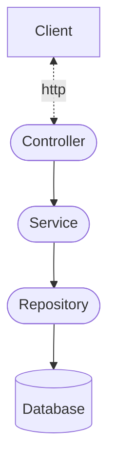

# Architecture Documentation

## Overview
This document describes the architecture of the Social Media Backend project.
It explains the responsibilities of the main components, how they interact with each other

## Architecture Diagram


*Note: This diagram represents a typical layered architecture. 
It should be updated to reflect the components actually implemented in the project.*

## Component Responsibilities
### Client
The client sends HTTP requests to the backend and receives HTTP responses.

### Controller layer
The controller only handles incoming HTTP requests and returns appropriate HTTP responses.

### Service Layer
The service layer contains the application's business logic.

### Repository Layer
The repository layer handles data access.

### Database
The database stores application data persistently.

## Code Architecture

The code architecture is featured based

```
src/
├── controller/
│   ├── ...
│   ├── ...
│   └── ...
├── exception/
│   ├── ...
│   ├── ...
│   └── ...
├── model/
│   ├── ...
│   ├── ...
│   └── ...
├── repository/
│   ├── ...
│   ├── ...
│   └── ...
├── service/
│   ├── ...
│   ├── ...
│   └── ...
```

