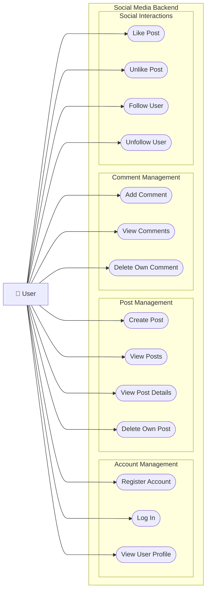

# User Cases

## Overview
This document describes the main use cases of the Social Media Backend project.

The purpose of this document is to identify the interactions between users and the system, 
describe the main features, and define the expected behavior of the application.

## Actors
The system has only the **User** as main actor.
- **User** : A person who interacts with the application to create an account, 
access their account, view profiles, and use social media features.

## Use-Case Diagram

The following diagram represents the main use cases planned.

## Note
This document describes my vision for the project. 